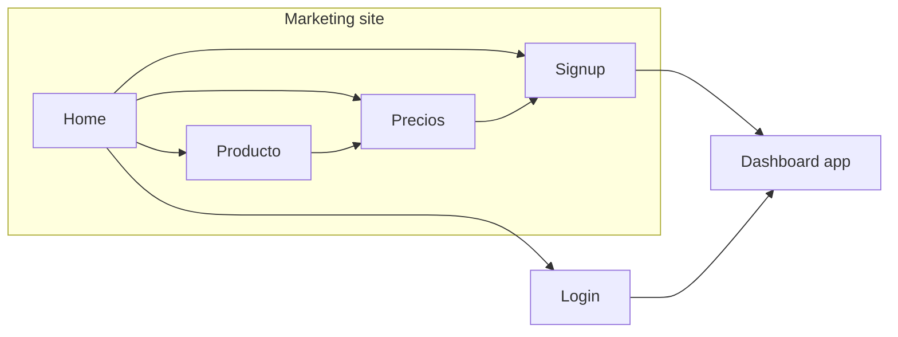

# Horaya marketing site — baseline

This is the source of truth for information architecture, sections, and look of the public site. It is inspired by [Calendly](https://calendly.com/?redirect=false), [Cal.com](https://cal.com/es/), and [Koalendar](https://koalendar.com/), then brought down to **Horaya**: clinic operations software, not a generic meeting scheduler.

Copy language: **Spanish**. Dashboard login/signup stay on `https://app.horaya.mx`.

---

## 1. What those three sites actually do

They sell different brands, but the **page machine** is the same.

| Pattern | Calendly | Cal.com | Koalendar |
| --- | --- | --- | --- |
| Promise | Scheduling is simple, at any scale | Customizable scheduling infrastructure | Smart scheduling, forever free |
| Hero | One line + dual CTA + product UI | One line + dual signup + live booking widget | One line + “no card” + product UI |
| Proof | Fortune 500 / 100k orgs | Fast-growing company logos | 10k+ professionals, store ratings |
| How it works | 5-step product walkthrough | 3 numbered steps | “Ready in minutes” |
| Features | Benefit + screenshot, then integrations | Deep feature grid + reminders | Feature clusters + verticals |
| Pricing | Homepage teaser + `/pricing` matrix | Homepage light, `/pricing` heavy | Homepage comparison table |
| Trust close | Case-study metrics, security | Testimonials, FAQ, HIPAA/SOC | Reviews, professions, FAQ-ish chat |
| CTAs | Start free + Get a demo | Comienza + Habla con ventas | Start free (self-serve first) |

Shared chrome, every time:

- Sticky header: logo, product, pricing, login, primary CTA
- Dual CTAs: self-serve vs sales (Calendly/Cal). Koalendar leans self-serve.
- Homepage as a **story**, not a dump of features
- Product UI in the hero (the site *shows* the tool)
- Footer as a sitemap
- Repeated “start now” band before the footer

What we **do not** copy:

- Calendly’s “for every meeting in the Fortune 500”
- Cal.com’s open-source / developer / self-host story
- Koalendar’s koala-mascot warmth and “every profession” grid (sales, barbers, photographers…)
- Fake logos, invented metrics, or competitor comparison tables until we have real numbers

What we **do** take:

- Calendly’s calm, spacious, enterprise-quiet layout
- Cal.com’s “show the real product” hero and a short how-it-works
- Koalendar’s plain-language benefits and a pricing page that is scannable
- All three: homepage teaser → dedicated `/precios`, features on homepage → dedicated `/producto`

---

## 2. Our positioning

Horaya is the **operating system of the clinic**, not a booking link.

Calendly / Cal / Koalendar stop at “someone picks a time.” We continue into the visit: client record, intake, services, clinical notes, hours, and staff administration.

**Audience:** owners and staff of small-to-mid clinics (physio first, other practices later). Spanish-speaking, self-serve.

**Job to be done:** stop running the practice from WhatsApp, paper, and a shared Google Calendar.

**Promise (working):**
*La clínica, en un solo lugar.*
Agenda, clientes, formularios e historial clínico — sin el ida y vuelta.

**Not this:** “The smartest way to schedule meetings.”
**This:** “The clinic runs itself while you treat.”

Three product pillars (`/producto`; homepage teases them via setup, capabilities, and journey):

1. **Agenda** — hours, services, appointments, calendar sync
2. **Clientes** — records, intake forms, and the ficha
3. **Clínica** — notes, continuity of care, staff admin

If a section does not serve one of those pillars, it does not belong on v1.

---

## 3. Site map

Keep the first version small. These sites look large in the footer; their **conversion path** is three pages plus auth.

```text
horaya.mx                         marketing (this repo)
app.horaya.mx                dashboard (Habemusfisio-ui)

/                   Home
/producto           Product / features
/precios            Pricing
/seguridad          Privacy & trust (short)
/clinicas           Campaign landing (ads). Not in the header.
/privacidad         Políticas de privacidad (footer)
/terminos           Términos y condiciones (footer)
404                 Not found → home / producto / precios
/login              → app login
/signup             → app signup (or login while signup is gated)
```

Out of v1: blog, use-case microsites, careers, changelog, “vs Calendly”, comparison tables, chatbot. `/clinicas` is the ad landing (one action, price up front, no header nav). It is not a use-case microsite. On that page only, a fixed mobile signup bar may sit above the cookie notice. That script is not used on the brochure pages.



---

## 4. Global chrome

### Header (sticky, light)

| Left | Center | Right |
| --- | --- | --- |
| Logo wordmark | Producto · Precios | Iniciar sesión · **Comenzar** |

- `Comenzar` is the only filled button (brand `#1769e0`). Label in UI: `Comenzar gratis`.
- `Iniciar sesión` is text. Same dual-path as Calendly, without a “Talk to sales” until we have sales.
- On mobile: logo + Comenzar; the rest in a simple drawer. Do not copy mega-menus.
### Footer

Four columns, quiet:

1. Producto, Precios, Seguridad
2. Iniciar sesión, Comenzar
3. Políticas de privacidad (`/privacidad`), Términos y condiciones (`/terminos`)
4. Short brand line + email

No 40-link Cal.com footer. No social proof wall in the footer.

### Dual CTA rule

Every major band ends with **Comenzar**. Secondary link is **Ver precios** or **Ver producto**, never a second competing primary.

---

## 5. Home (`/`) — section by section

This is the page that has to work alone. Order is the conversion story, not the org chart.

**Shipped order:**
Hero → Problem → Visit (`#recorrido`) → Cómo empezar (`#como-empezar`) → Operational breadth bento → Integrations → Pricing teaser → FAQ → Closing CTA

Do **not** ship Agenda/Clientes homepage pillars or a warm mid-page CTA. Continuity lives in Journey and `/producto`.

### 5.1 Hero

- Eyebrow (status-dot pill): `Para clínicas`
- H1: `La clínica, en un solo lugar.`
- Sub: `Agenda, formularios, fichas y notas, fuera del chat y del calendario compartido.`
- CTAs: `Comenzar gratis` + `Ver una visita` (anchor `#recorrido`)
- Trust line under buttons: `Plan gratuito` · `Configuración en minutos` (do not claim “sin tarjeta”)
- **Visual:** first screen. `min-height: calc(100svh - var(--header-h))`, content vertically centered, extra bottom padding so Problem starts on the next scroll. Split layout from 900px (copy left, product right). ProductFrame variant **`panel`** (visit panel / today’s flow), not the week grid — the cropped agenda lives in the visit, not here. `Ingreso completo` and `Nota lista` sit on the frame: readable, visible in the layout, and **not** `aria-hidden`. No perspective or `rotateY` tilt on the hero mock. On small screens, copy then a compact panel frame with the same two signals. No isometric 3D, no mascot, no stock photography. Do not restore sidebar or a 5-day week. The hero does not run a rotating visit-state sequence; that story is `#recorrido`.

### 5.2 Logo / proof strip

A single quiet line, then 4–6 marks **only when real**. Until then, skip this section rather than inventing “trusted by.”

Optional later: a metric row *only with real data* (citas, clínicas, no-show drop). Koalendar’s “10M+ classes” pattern is useful; fake numbers are not.

### 5.3 Problem

Separate chapter after the hero: extra top padding (~4–5rem) and a warm/paper band (`--color-warm` mix) so Hero and Problem do not share one canvas.

Problem is a dossier of three cases, not a matching 3-up card grid. Each case is a documentary still plus copy. From 640px the still sits beside the copy; on small screens the still stacks above. Scenes stay neutral so the visit reads as what comes after: case 1 uses `--color-frame` (no brand wash) and the outgoing chat bubble is an ink mix, not brand. Cards do not lift on hover. Chat bubbles, empty ficha rows, and follow-up warnings enter once; “Sin respuesta” breathes only while the section is in view, and under reduced motion it stays at full opacity.

| Scene | Title | Line |
| --- | --- | --- |
| Chat (`¿Tienes el jueves a las 5?` → `Deja checo y te aviso` → muted “Sin respuesta · 2 h”) | Dijiste que revisabas y no contestaste | El interesado pregunta si hay hueco. Tú ibas a mirar el horario. El mensaje se quedó visto. |
| Sparse ficha / visits greyed / “sin historial” | Cada visita empieza de cero | Lo de la sesión pasada no está en la ficha. Vuelves a preguntar lo que ya sabías. |
| `Sesión 6 · finalizada` + `Sin próxima` + `Plan no registrado` | La sesión termina y el hilo se corta | No hay próxima cita, ni plan a la vista, ni recordatorio. El seguimiento vive en la cabeza. |

Headline: `Hoy la clínica se arma en el chat.`

### 5.4 Cómo empezar

Numbered process (`ol`), id `como-empezar`. White cards on a `--color-frame` band: the number sits in a pill inside the card, top left (Outfit, tabular numerals, `--color-frame` pill, `--color-ink-mid` text), then the title and line, then the mock cropped by the bottom edge of the card. No connector line and no vertical rail. From 860px the three steps are equal-height columns. No inner gray stage and no hover lift. One button: `Comenzar gratis`. No ghost link back to the visit.

- Label: `Cómo empezar`
- H2: `Empezar no debería tomar una semana.`
- Lead: `Horario, servicios y formulario de ingreso. Con eso, la próxima visita corre como la acabas de ver.`

| # | Title | Line | Frame |
| --- | --- | --- | --- |
| 01 | Define tu horario | Los días y horas en que atiendes. | `hours` compact, micro `availability` |
| 02 | Da de alta tus servicios | Qué ofreces, cuánto dura y cuánto cuesta. | `services` compact |
| 03 | Prepara el formulario de ingreso | Los datos y el motivo de consulta que quieres antes de la cita. | `intake` compact |

Step 03 carries a quiet plan note: `Formularios de ingreso: en Equipos y Empresas.`

### 5.5 Product pillars

Homepage does **not** ship separate Agenda or Clientes bands. Those groups live on `/producto`; the Home breadth section below covers operational setup around the visit without repeating the Journey story.

Do **not** ship a separate Clínica homepage band.

### 5.6 Journey (how a visit flows)

Placed after the problem bridge and before Cómo empezar. Paper band, id `recorrido`. Headline: `El contexto avanza con cada visita.` Secondary text link: `Comenzar gratis`. No primary button in this band.

One markup of four `<article>` chapters. Below 860px they stack as cards (no tab roles, no `hidden`, no autoplay); each card is at least one screen, unless the viewport is 640px tall or shorter. From 860px, JS turns them into tabs (`role="tablist"` / `tab` / `tabpanel`, arrows, `aria-selected`, roving `tabindex`) via `matchMedia('(min-width: 860px)')`, and tears that down when the viewport crosses back. Without JS they stay stacked on desktop too. The rail sits on `--color-frame` above one white card. The card is two columns: copy on white, tinted stage on the right, fixed at `34rem` so a tab change does not shift the page. No outer float container.

Autoplay is one pass, about 6s per chapter, 01 → 04, then it stops on 04 with the progress bar full. It does not loop. It starts when the section is in view, pauses off-screen and on hover or focus, and a click or arrow stops it for good. Leaving early resumes from the current chapter. `prefers-reduced-motion`: no autoplay, chapter 01 selected, instant tab change, full progress bar on the active tab.

Each chapter has a kicker, title, remate, copy, a three-step timeline (existing `status-dot` classes), an optional plan note, and one tinted ProductFrame. Tints are visit-only (`--tint-cita`, `--tint-ingreso`, `--tint-ficha`, `--tint-seguimiento`, plus glow and key). Chapter 02 plan note: `Formularios de ingreso: en Equipos y Empresas.` Entrance runs once: copy is already visible, the tint reveals, the mock lands, one protagonist product state plays, then the timeline dots take their state with a single ring.

1. **La cita entra en la agenda** — hueco del jueves 17:00 en la agenda (bloque `17:00 · Revisión` en la columna Jue)
2. **El ingreso llega con tiempo** — formulario antes del box
3. **La ficha abre con contexto** — datos, visitas y nota previa
4. **El seguimiento queda preparado** — nota, próxima cita y plan

Tab labels: `Cita confirmada`, `Ingreso recibido`, `Contexto listo`, `Seguimiento preparado`. Agenda visual rule: journey step 1 may reuse agenda inside journey chrome and highlights Thursday 17:00; the hero does not show the week grid.

### 5.7 Operational breadth

Label: `Más que una agenda`. Title: `La operación alrededor de la visita.` Lead: `El panel del día, los roles del equipo y el detalle de cada pieza. Sin otra herramienta.`

Use an asymmetric editorial bento: one dominant **Panel principal** scene for today’s appointments, statuses, quick actions, and pending intake; four smaller operational tiles for **Servicios** (color chips per service), **Formularios** (brand, consent, and signature on one row), **Horario** (a date exception and timezone, not the weekly blocks), and **Equipo y roles** (Owner/Manager/Staff access). The dominant panel and four tiles are static focused ProductFrame/CSS scenes, not tiny full-app screenshots, icon soup, or another carousel. Tile copy: `Color por servicio, para distinguir cada atención de un vistazo.` · `Tu marca, consentimiento y firma en el mismo formulario.` · `Excepciones de fecha y zona horaria, sin rehacer la semana.` The panel line stays `Hoy, sin buscar en cinco lugares.` No variant and `micro` pair is repeated between Cómo empezar and this bento. Give the four smaller tiles enough separation to read as independent objects, using the current double soft shadow. Stages use `--color-frame`. No category accent tint and no 3px accent bar. No hover lift. Desktop uses a 12-column composition; tablet uses a balanced dominant-plus-2×2 treatment; mobile stacks without overflow. One CTA, `Ver todas las capacidades`, points to `/producto`. Quiet plan note under the bento: `Formularios, equipo y roles: en Equipos y Empresas.`

The problem section flows into the visit through one short narrative bridge, not solution badges repeated inside each problem card.

**Shipped bridges:**

- Problem → Visit: `El chat no es un sistema.` Así se ve el mismo jueves cuando la visita vive en un solo lugar.
- Integrations → Pricing: `El plan cubre la operación.`

### 5.8 Mid-page CTA

Do **not** ship a warm mid-page CTA. The closing navy band is the only full-width CTA on the homepage.

### 5.9 Integrations

One quiet shared strip/row on `--color-surface` (no brand tint): Google Calendar + Apple Calendar. The strip does not float. Headline `Se conecta con lo que ya usas.` Copy talks about appearing in calendars the team already uses. Plan note under the lead: `Incluido en Equipos y Empresas.` Do not label the cards `Una vía` or `Solo lectura`. Text link to `/producto#integraciones`.
Do not show Zoom/Salesforce/Zapier just because Calendly does.

### 5.10 Pricing teaser

Three plan cards: **Gratis**, **Equipos** (marketing name for API plan id `business`; list `$249 MXN` monthly / `$199 MXN` annual per seat; launch promo `$199 MXN / asiento / mes`, or `$149 MXN / asiento / mes` billed annually as `$1,788` — 25% off vs monthly promo / `$600` saved per seat), y **Empresas** (contact sales only — not a third API plan; includes everything in Equipos plus dedicated accompaniment as already described). A compact `Mensual / Anual` toggle appears above the cards on Home and `/precios`; Mensual is the default and Anual carries a visible `−25%` label. Both periods show the list price struck through next to the launch price, plus a `Promoción de lanzamiento` chip. Equipos shows a visible `Recomendado` pill and a solid primary CTA labeled **`Comenzar`** (never `Elegir Equipos`) on both Home and `/precios`; under that button, a visible line that the plan is chosen inside the panel (e.g. `El plan lo eliges en el panel`). Gratis CTA stays **`Comenzar gratis`**; Empresas remains a text link. Signup at the dashboard only creates an account — it cannot receive a plan from the marketing site. Beside the price actions, three quiet trust lines (each links to `/seguridad`): `Datos aislados por clínica` · `El paciente no tiene panel` · `No vendemos listas`. One handoff line under the primary signup path: the next screen is the panel at `app.horaya.mx`. Link to `Ver precios` / comparar planes; do not publish competitor comparison tables.

### 5.11 Testimonials

Two or three quotes max, with name, clinic, city. Empty until real. Do not use Cal.com’s scrolling wall of tweets.

### 5.12 FAQ (5–7 questions)

Two-column on desktop: intro left (optional text link `Comenzar gratis`, not a second primary button), accordion list right. Open panels animate height; reduced motion = instant.

Draft:

1. ¿Por qué usar una herramienta de gestión si ya tengo WhatsApp y Calendar?
2. ¿Qué diferencia a Horaya de una agenda online?
3. ¿Cómo sé si Horaya encaja con mi clínica?
4. ¿El paciente necesita crear una cuenta?
5. ¿Puedo adaptar la herramienta a la forma en que trabaja mi equipo?
6. ¿Dónde quedan los datos de mi clínica?
7. ¿Puedo empezar sin comprometerme a pagar?

Answers: two to four sentences. Link `/seguridad` from the data question.

### 5.13 Closing CTA

Full-width navy band.
H2: `Empieza con la próxima cita.`
Label: `Siguiente paso`
Copy: `Reserva, ingreso, sesión y seguimiento, sin reconstruir la historia. Plan gratuito para comenzar.`
Buttons: `Comenzar gratis` + `Ver precios`.
Right side: quiet 4-step strip — Reserva → Formulario → Sesión → Seguimiento (`showFlow` on homepage only).
---

## 6. Producto (`/producto`)

Calendly `/features` shape: hero, then grouped capabilities, then CTA. Not a second homepage.

**Hero:** distinct from home — H1 `Agenda, clientes y clínica, en el mismo flujo.` + `Comenzar gratis` / `Ver precios`
**Hero visual:** one agenda ProductFrame under the hero copy (do not clone the homepage panel hero). It may use the same in-view ambient float as the home hero. Group mocks stay still.

**Groups** (match the live dashboard, not a scheduler feature list). Odd groups sit on paper; even groups sit on `--color-frame`, with no brand wash. The index is a neutral pill (Outfit, tabular numerals, `--color-ink-mid`; `--color-frame` on paper, `--color-surface` on a frame band). Item markers are ink. Paid groups carry one quiet plan note, `En Equipos y Empresas.`, and do not repeat the plan in the intro. Titles for Agenda, Clientes, Clínica, and Formularios are inventory lines, not the home visit chapter titles.

1. **Panel principal** — citas de hoy, estados, acciones rápidas, ingresos pendientes. Title: `Hoy, sin buscar en cinco lugares.`
2. **Agenda** — Citas, Servicios, Horario (excepciones y zona horaria). Title: `Horario, servicios y citas, en una sola semana.` Google and Apple Calendar are not listed here.
3. **Clientes** — perfil, fichas, visitas e historial. Title: `Cada cliente, con su historia.`
4. **Clínica** — notas, seguimiento y continuidad (group mock: note frame highlighting **Citas**; the product sidebar has no Clínica item). Title: `Notas y seguimiento, sesión tras sesión.`
5. **Formularios** — diseñador de ingreso, marca, consentimiento y firma. Title: `Ingreso, consentimiento y firma, antes de la cita.` Plan note.
6. **Administración** — usuarios, roles Owner/Manager/Staff, branding y configuración. Plan note.
7. **Integraciones** — Google Calendar y Apple Calendar, únicamente lo que está vivo. Plan note.
8. **Automatizaciones** — recordatorios por email y SMS alrededor de la cita (present tense; live today). Plan note only.
9. **Reportes e insights** — paneles e insights para la organización (present tense; live today). Plan note only.

Each group: H2, short intro, item list (title + one line). One product mock per group, not per item.

Close with the same CTA band as home.

---

## 7. Precios (`/precios`)

Calendly `/pricing` shape, Koalendar scannability, our plans.

1. H1: `Empieza gratis. Crece con tu equipo.`
2. Billing toggle (`Mensual` by default; `Anual` shows `−25%`, the $149 MXN / month launch price, and $1,788 MXN billed per seat per year)
3. Plan cards (audience label, price, 5–8 bullets, CTA)
4. Feature comparison table (rows grouped: Agenda, Clientes, Clínica, Equipo). Rows **`Workflows y recordatorios`** and **`Reportes e insights con IA`**: `Incluido` on Equipos and Empresas; `—` on Gratis. Do not use `Próximamente` or future tense for those rows.
5. FAQ (what counts as a seat, trial, invoices, what happens if you cancel)
6. Closing CTA

Do not add “vs Calendly / Cal.com / Koalendar.” Different category; that table would confuse the buyer.

Plans: Gratis, Equipos (API id `business`; list `$249` / `$199` annual; launch `$199 MXN / asiento / mes`, or `$149 MXN / asiento / mes` when billed annually), and Empresas (contact sales only). Equipos card CTA: **`Comenzar`**, plus the panel plan-choice line, the three trust lines linking to `/seguridad`, and the handoff line to the panel at `app.horaya.mx` (same rules as the homepage pricing teaser). From 860px the Equipos card stays slightly raised. It does not lift further on hover. Its light brand wash and `Recomendado` pill stay. In the comparison table the Equipos column is ink at weight 600, not brand. Row rules stay.

---

## 8. Seguridad (`/seguridad`)

Short trust page (Calendly “built to keep you secure,” without enterprise theater).

- Who can see clinic data (tenant isolation, roles)
- What patients see (intake link, no dashboard)
- What we do not do
- Links to `/privacidad` and `/terminos`

The three blocks do not lift on hover. Their numbers use the same neutral pill as Cómo empezar (`--color-frame`, `--color-ink-mid`). The legal note sits on `--color-frame`, not a brand wash.

No SOC/HIPAA badges unless they are real.

---

## 9. Look and feel

Luxury refined minimalism, same family as the dashboard — marketing is allowed to use real titles and a larger hero.

| Token | Value |
| --- | --- |
| Type | Outfit |
| Ink | `#171717` |
| Muted | `#6b6b68` |
| Paper | `#fafaf8` |
| Surface | `#ffffff` |
| Brand | `#1769e0` — primary actions and focus only. One visit exception: chapter 01 may use brand as wash, glow, kicker dot, tab dot, and progress bar — never as text, a button, or a solid fill, and in no other section |
| Depth | Soft shadow, no card borders |
| Radius | Medium, same as product |
| Motion | Fade/slide on scroll, one-shot product-state reveals, visit entrance once per chapter (tint, mock, one protagonist state), desktop visit autoplay one pass (~6s, no loop), FAQ height, billing toggle swap; ambient 3px float only on the hero panel and its signals while in view; problem scenes enter once and “Sin respuesta” breathes only while that section is in view; `prefers-reduced-motion` shows the final state immediately, with no float and no autoplay |

**Closer to Calendly than Koalendar:** lots of air, typography hierarchy, product shots on paper, and an editorial monochrome shell. Color comes from product UI, icons, motion states, and restrained primary actions.
**Closer to Cal.com than Calendly:** the screenshot *is* our app, not an illustrated metaphor.
**Not Koalendar:** no mascot, no rainbow of vertical cards, no “free forever” personality unless that is the real offer.

Rules:

- One H1 per page
- Section labels are small + muted; section titles are large + light-to-medium weight
- Primary button once per band
- Dual CTAs: self-serve primary; secondary is text or ghost (`Ver precios`, `Ver producto`, `Ver una visita`)
- Status and proof use dots / quiet text, not filled badges (except pricing `Recomendado` pill)
- Product UI mocks use existing status/appointment tokens for quiet color — not beige + one blue button only
- No hardcoded one-off colors; CSS variables only
- No Calendly organic blobs / illustration style
- Static HTML first. JS only for the header drawer, billing toggle, journey tabs (desktop, `matchMedia` at 860px), FAQ accordion, reveal, ambient pause of the in-view hero, one-shot product-state entry, the cookie notice (localStorage preference only; no analytics), and a short first-paint page loader. Animate product state, never bouncing marketing text. The visit entrance animates only `opacity`, `transform`, and `clip-path`: copy is already visible, the tint reveals with `clip-path`, the mock lands from scale 0.96, one protagonist state plays, then timeline dots take their color with a single ring. Limits: at most 12px of travel, scale never below 0.96 or above 1 except the one-shot ring, `--ease-out` with no bounce, each four-beat entrance within 1.2s, no loop inside the visit. Desktop tab changes crossfade copy (200ms out, `--duration-crossfade` in) with no `translateY`, then replay tint, mock, and protagonist. Autoplay is one pass. Cómo empezar reveals availability blocks, service rows, and intake fields once. The bento reveals panel rows and each tile’s product state once, without floating or hover lift. Ambient 3px float stays on the hero only. Visit tints are exclusive to `#recorrido`. Plan notes are quiet 0.8rem `--color-muted` text, present tense, no pill: chapter 02, Cómo empezar step 03, the bento footer, and integrations. **No Three.js, WebGL, or WebGL-based libraries.** `scroll-behavior: smooth` only without `prefers-reduced-motion: reduce`. Reduced motion shows the final state immediately, including a static “Sin respuesta” at full opacity, no float, and no visit autoplay. `/clinicas` may also run the fixed mobile signup bar and the cookie clearance described above.
---

## 10. Voice

- Address the clinic owner: `tú`
- Concrete nouns: cita, ficha, horario, inasistencia — not “sinergias”
- Short sentences. One idea per heading
- Spanish from Spain/LatAm-neutral; match dashboard copy (`Citas`, `Clientes`, `Formularios`)
- Never claim a feature the app does not ship
- Never claim certifications, analytics, or tracking we do not have
- **Automatizaciones** (email/SMS alrededor de la cita) and **reportes e insights** are live on the paid plan (Equipos and Empresas). Do not offer them on Gratis. Do not use future tense or `Próximamente` for those capabilities.

---

## 11. v1 vs later

**v1 (this repo, now)**

- Chrome (header/footer)
- Home with all sections except empty proof/testimonials (omit if empty)
- `/producto`, `/precios` (structure), `/seguridad` (short)
- `/clinicas` ad landing (not in the header)
- `/privacidad`, `/terminos` (footer legal)
- 404 (home / producto / precios)
- Cookie notice (essential preference in localStorage; no ads/analytics cookies)
- CTAs pointing at the app

**Later**

- Real logos, quotes, metrics
- Sales / demo CTA
- Blog or guides
- Extra locales
- Comparison or “vs” pages only if we compete with clinic software, not with Calendly

---

## 12. Implementation notes

- Astro pages, shared `BaseLayout`, CSS variables in global styles
- Product shots: real dashboard captures (light scheme), lightly framed
- `Comenzar` / `Iniciar sesión` are absolute URLs to the app origin (env), defaulting to `https://app.horaya.mx`
- No auth, no org context, no API client in this repo
- Hosting: S3 + CloudFront via CDK in `infra/` (see `infra/README.md`). Production domain is `horaya.mx`. DNS is the existing Route 53 zone in the Horaya account; the stack writes apex and `www` aliases. Dashboard stays on `app.horaya.mx`.
